# SatMap

A map for flying drones, for iPhone and Android: satellite imagery, contour lines and elevation colours, your
position (with a compass arrow), height and dotted track, your KML and GPX files, a measuring tool with live
distance and height difference, and offline satellite maps of areas you draw (or take from a KML or GPX file), at
the highest detail the imagery has.

Native on both: Swift + MapKit on the iPhone, with no third-party dependencies; Kotlin + Jetpack Compose +
MapLibre on Android (`android/`). The two apps look and work the same, and offline maps exported on one restore
on the other.

## Screenshots

Taken automatically in the iPhone simulator on a vineyard near Stellenbosch, with a simulated walk and a demo
KML of the farm's blocks (`.github/workflows/screenshots.yml`).

| Map: satellite, contours, blocks, track | Measuring: crosshair | Measuring: live distance and height |
| --- | --- | --- |
|  |  |  |
| **Blocks (KML files)** | **Blocks on the map** | **Offline maps** |
|  |  |  |
| **Download an area (from a KML)** | **Downloading** | **Offline areas** |
|  |  |  |
| **Drawing an area with the lasso** | **Contours and colours off** | **Download only along roads** |
|  |  | 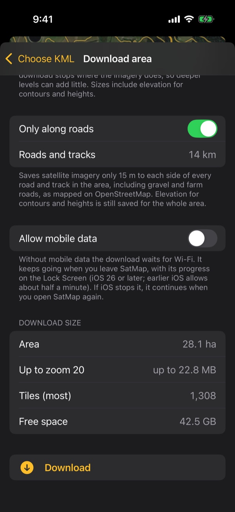 |
| **Whole area and along roads** | **Exporting a backup** | **Coordinates of a tapped spot and of you** |
| 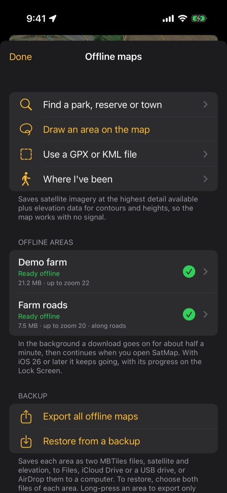 | 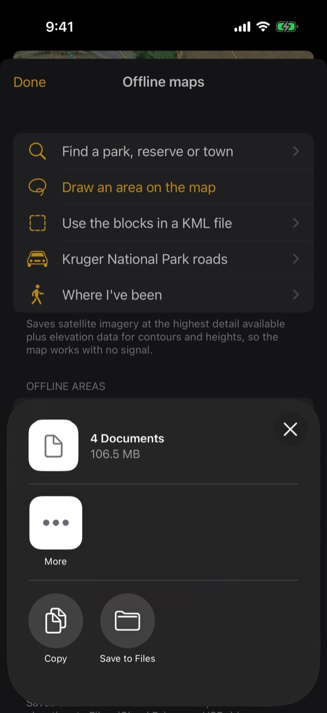 | 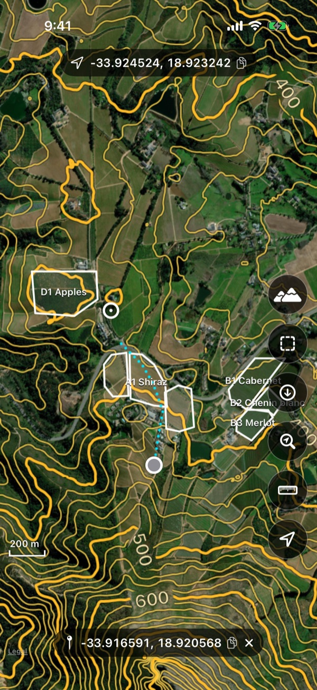 |
| **Measuring between two points** | **Choosing a GPX or KML file** | **One level deeper for an area** |
| 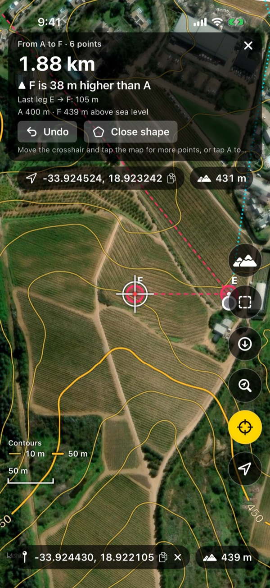 | 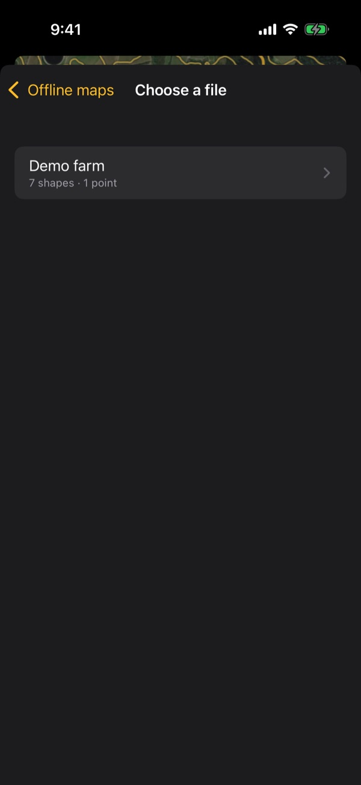 | 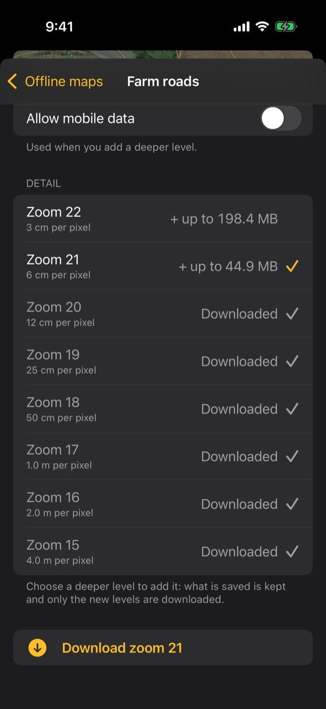 |
| **Measuring a shape's area** | **Where I've been** | **Go to coordinates** |
| 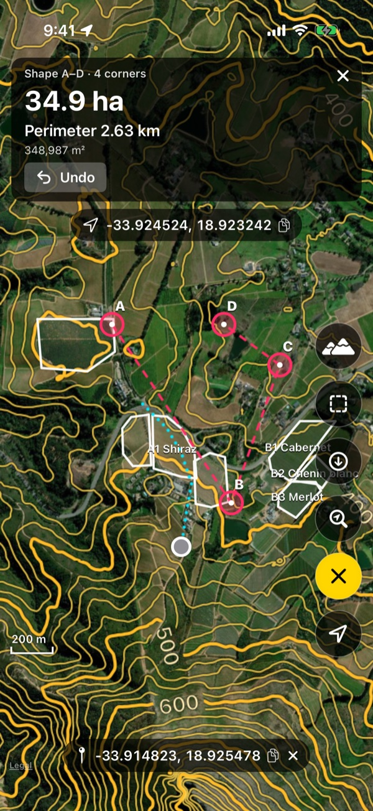 | 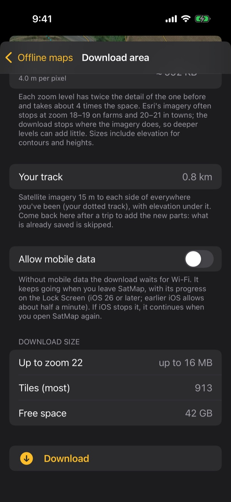 | 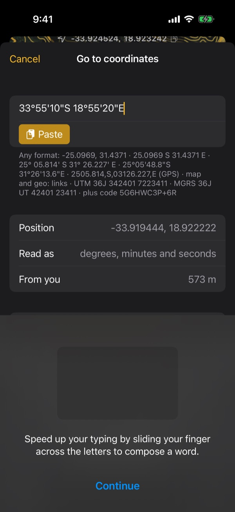 |
| **Contour lines with elevation colours** | **Elevation colours only** | **A KML point selected** |
| 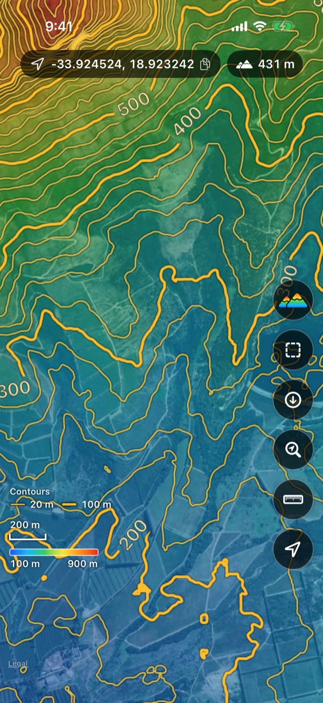 | 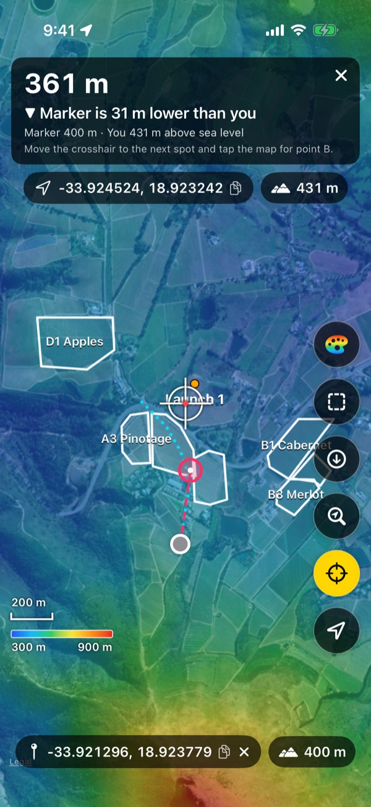 | 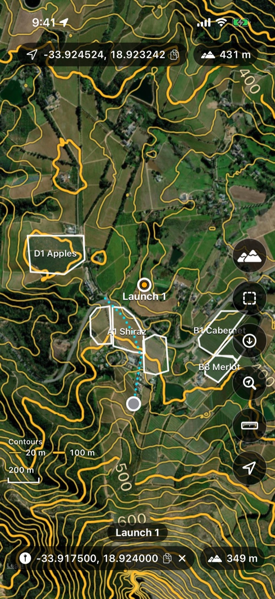 |
| **Drone mode** | **Finding a place to save offline** | **Saving a reserve within its boundary** |
| 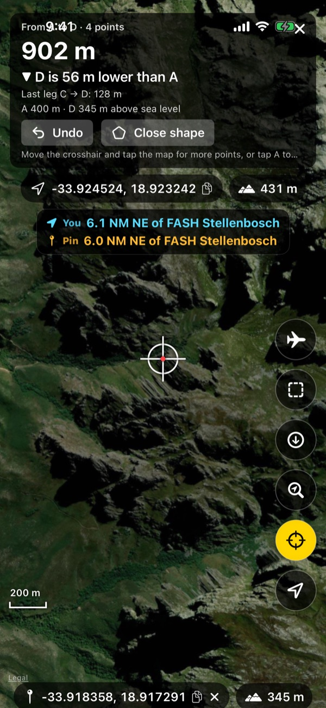 | 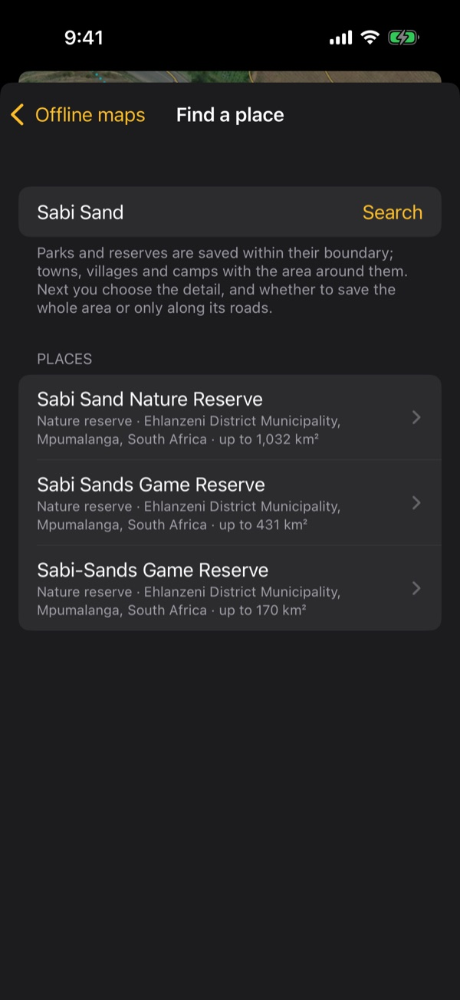 | 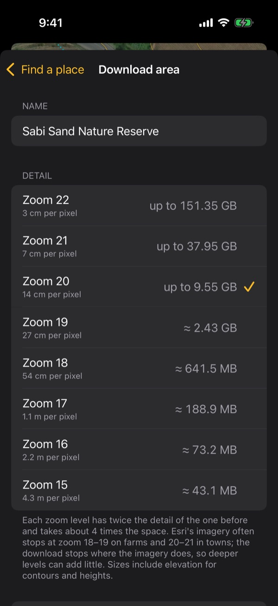 |

The Android app's screenshots, taken the same way on an Android emulator (`.github/workflows/android-screenshots.yml`),
are in [docs/screenshots/android](docs/screenshots/android):

| Map | Measuring | Offline maps | Drone mode |
| --- | --- | --- | --- |
| 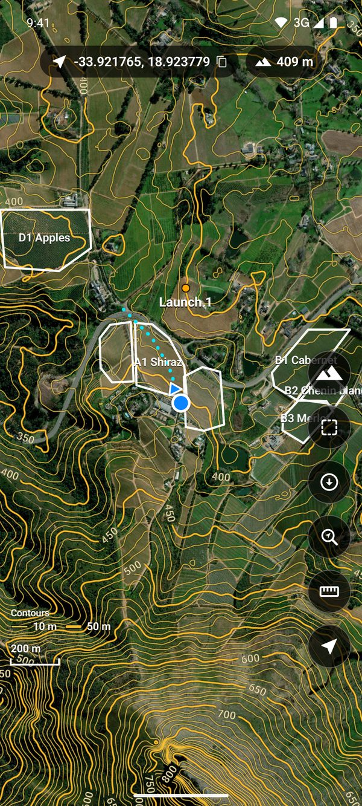 | 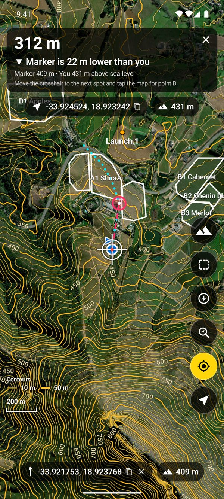 | 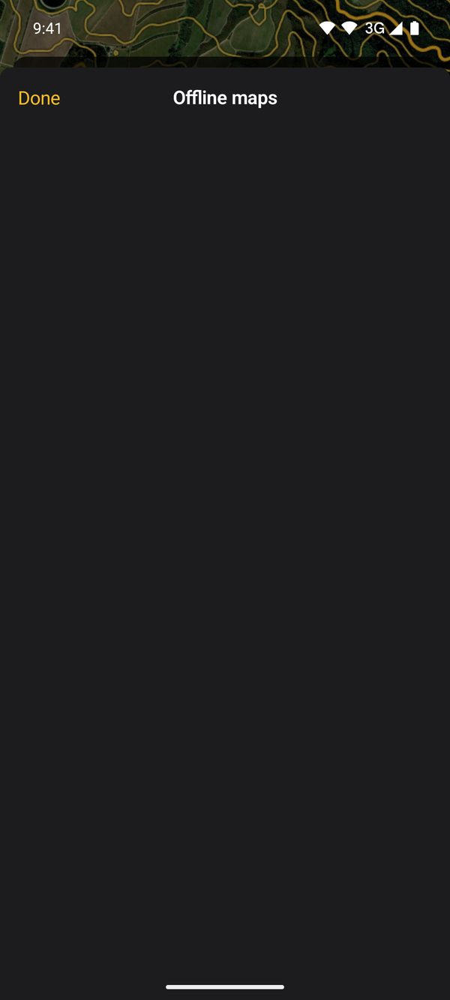 | 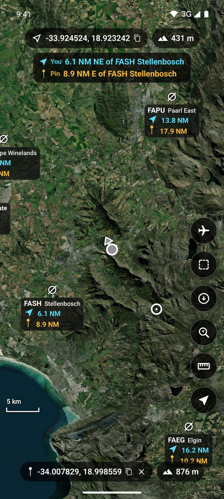 |

## Features

| What you asked for | How it works |
| --- | --- |
| Satellite view | Esri World Imagery tiles drawn over MapKit (Apple's own map is switched off). SatMap draws the imagery itself: every spot at once with the best imagery already in memory (the coarser tile enlarged when zooming in, the sharper ones shrunk when zooming out), with the contour lines on top, and swaps in a freshly drawn layer under the old one as better tiles arrive, so the map doesn't go grey while tiles load. In a new place it asks for a tile three levels up first (one request covers 64 tiles), and when the map stops it keeps coarse tiles around the screen ready for the next zoom or pan. |
| Contour lines and elevation colours | Drawn on the phone from elevation tiles (AWS Terrain Tiles). Contour spacing adapts to zoom: 100 m → 50 → 20 → 10 → 5 m, with every 5th line thicker and labelled. The elevation colours tint the map by height, blue for the lowest ground on screen to red for the highest, so high spots stand out; the range is chosen from the heights on screen (round numbers, at least 10 m) and kept while you pan around, so the colours stay put. The mountain button at the top of the side buttons cycles through contour lines → contour lines with colours → colours only → neither (remembered; a label says which). On the left, the contour interval shows above the scale bar and the colours' heights below it. Works offline for downloaded areas; with neither shown, no elevation is downloaded for the map. The same button's next mode is **drone mode** (the plane): the airports, airstrips, helipads and radio beacons (VOR, NDB) around, from [OurAirports](https://ourairports.com) (public domain, shipped with the app, so it works offline), more of them as you zoom in. Each shows its code and name, how far it is from you in nautical miles (cyan) and, once you tap a spot, from that spot (amber). A card at the top says where you are as a pilot reports it ("3.2 NM NE of FASZ Skukuza"), and where the tapped spot is. Tap an airfield to select it: the distances to the others are then from it. Visual reporting points and airspace aren't in the open data, so they aren't shown. |
| My location + dotted track | Blue dot (grey while the GPS sleeps) with a small arrow pointing where the phone points (the compass; it turns with the map) and a cyan dotted line of where you have been. Recording continues in the background. Long-press the locate button to clear the track. |
| KML and GPX files | **Blocks** button → **+** to import `.kml`/`.kmz`/`.gpx` from Files, or share a KML or GPX file from WhatsApp/Mail/Files to SatMap. Blocks are drawn in the file's own colours and line widths (what a file leaves unset is white), with their names. A GPX file's tracks and routes are drawn as white lines and its waypoints as points (GPX has no colours). Each file has a switch to take its blocks off the map and put them back; untick **Use the colours in the files** to draw every block in white. Long-press the **Blocks** button to switch files (and the colours) without opening the list. Points in a file (launch points …) show as a dot with their name; tap one to select it at its exact position, with its name, coordinates and height at the bottom. Tap a file to zoom to it. Swipe to remove. |
| Measuring tool | Tap the ruler: a crosshair appears in the centre of the screen. Move the map to put the crosshair on the spot, then tap anywhere on the map (or the ruler again) to drop a marker under the crosshair. As you walk, a dashed line joins you to the marker and the panel shows the live distance and how much higher or lower the marker is than where you are (from the elevation model). Add more points the same way (B, C, D …): the panel shows the total distance along the line, the last leg, and how much higher or lower the last point is than A. Tap A, or put the crosshair on A and tap (or **Close shape**), to close the shape: its area (hectares and m²) and perimeter. **Undo** removes the last point; ✕ clears it all. Tap the distance (or the scale bar) to show distances in kilometres, miles or nautical miles; the scale bar follows. |
| Go to coordinates | The button with the magnifying glass: paste or type a position in any common format (decimal degrees signed or with N/S/E/W; degrees and minutes; degrees, minutes and seconds with any symbols; decimal commas; GPS/NMEA; Google, Apple, OpenStreetMap and geo: links; UTM; MGRS; plus codes). It shows how it was read and how far it is from you; **Show and measure from here** puts it on the map as measuring point A, with the live distance from you, as if you had tapped it. |
| Coordinates | Your own coordinates (latitude, longitude in decimal degrees) show at the top and follow you, with your height above sea level beside them (from the elevation model; from the GPS, marked, where there is no elevation data). Tap a spot on the map: a pin marks it and its coordinates show at the bottom, within easy reach, with its height beside them. Tap either to copy it to the clipboard.  To move the pin or a measuring point precisely, press and hold it: a glass square above your finger shows 15 m × 15 m of ground around it, magnified. Keep your finger down and drag: the point follows at the square's scale, and beyond 5 m from the square's middle (the dashed ring) the map scrolls that way, faster the further you drag. Lift your finger to leave it there. Tap a height to show heights in feet, and again for metres. |
| Offline maps | **Offline** button → **Find a park, reserve or town** (search for Kruger, Sabi Sand, Skukuza, Hazyview …: parks and reserves are saved within their boundary from OpenStreetMap, towns and camps with the area around them; inside Kruger, "Only along roads" uses the road list shipped with the app), or **Draw an area on the map** (switch between *Move map* and *Draw*, then draw a loop around the area with one finger), or **Use a GPX or KML file** (the imagery inside the file's shapes and 15 m around its lines and points; see below), or **Where I've been** (along your dotted track; see below). Choose the detail: every zoom level from 15 (about 4 m per pixel) to 22 (about 3 cm) is listed with its download size, and your choice is remembered. Tick **Only along roads** to save imagery only 15 m to each side of the roads and tracks in the area (for a file: in its shapes; see below). Allow mobile data or wait for Wi-Fi, and download. |

### Offline downloads

- Imagery is downloaded zoom level by zoom level, up to the zoom you choose (at most 22, about 3–4 cm per
  pixel). The download screen lists the size for each level before you start: "≈" up to zoom 19, "up to"
  deeper, where the imagery often stops earlier and the download is smaller.
  Esri's imagery stops at different depths in different places, often zoom 18–19 on farms and 20–21 in
  towns. The downloader asks for a tile only if its parent exists, so it finds the real depth for every
  spot without wasting requests. On screen, anything deeper is enlarged from the best tile available.
- Elevation tiles for the same area are downloaded too, so contours and heights work with no signal.
- Up to 32 tiles are requested at once. Each takes about a quarter of a second whatever the number, so this is
  what makes a download fast (measured: 8 at once ≈ 30 tiles/s, 32 at once ≈ 95 tiles/s). The number adapts: it
  starts at 16, grows while tiles come back at the connection's normal pace, and drops by a quarter when requests
  fail or come back much slower than that (data queueing on a slow link, which would also slow the map on screen).
  A short gap that fails one round of requests doesn't stop the download: it only counts as offline when tiles
  sent after the failures began fail too.
- **Only along roads:** the roads are looked up on OpenStreetMap when you tick the box (all public roads,
  service roads, and farm and forest tracks, which is where most gravel roads are; not footpaths), and only
  the imagery within 15 m of each side of them is downloaded, at every zoom level. Away from the roads the map
  shows the nearest coarser imagery that was saved, enlarged. Roads missing from OpenStreetMap are missed too,
  so check the area first: rural tracks are not always mapped.
- **From a GPX or KML file:** each of the file's features is saved on its own, with nothing in between, however
  far apart they are. A shape (a KML polygon, or a closed line: a ring, or a line ending within 5 m of where it
  starts) is saved inside its outline, with nothing around it. A line (a KML line, a GPX track, its segments joined
  into one road, or a GPX route) is saved 15 m to each side, and a point (a waypoint) 15 m around it. A GPX track or
  route that ends where it started stays a road, so a round drive doesn't save everything inside it. Where the file
  says what a line is, that wins: first its data (a `highway` or `railway` field makes it a road; `landuse`,
  `boundary`, `building`, `leisure`, `natural` or `area=yes` a shape; other fields and a GPX `<type>` are read for
  the words below), then its name and description, then the names of its folders (words such as *road*, *track*,
  *firebreak* or *route* for a road, *block*, *field*, *paddock* or *area* for a shape). With **Only along roads**
  (when the file has shapes), roads are looked up inside the shapes only and imagery is saved 15 m to each side of
  them, and still 15 m around the file's lines and points; elevation is saved for the whole of each shape.
- **Kruger roads:** the boundary of Kruger National Park and every road in it (tar, gravel and management tracks,
  about the same road types as above) come with the app, from OpenStreetMap. An area inside the park (a place, a
  drawn area or a file's shapes) takes its roads from this list when saved along roads, so no lookup is needed.
  Areas saved with the earlier *Kruger National Park roads* button keep downloading along it.
  Refresh the list with the *Kruger roads* workflow (`tools/extract_kruger_osm.sh`, `tools/build_kruger_roads.py`); roads missing
  from OpenStreetMap can be added as KML/KMZ files in `tools/kruger-extra`.
- **Where I've been:** imagery 15 m to each side of your dotted track (the same as along roads), for when you
  leave the roads, with elevation under it. It is one area, "Where I've been", that you update: tap it again after
  a trip and the new parts of the track are added; what is already saved is skipped. Parts of earlier trips stay
  in the area even after you clear the track.
- **In the background:** a download keeps going when you leave SatMap or lock the phone. From iOS 26 it runs as a
  *continued processing task*: its progress shows on the Lock Screen and in the Dynamic Island (not while SatMap is
  open, where the banner on the map shows it), and you can stop it there. Earlier iOS versions allow about half a
  minute. If iOS ends it (low battery, other apps need the phone, or no progress for a while without signal), or
  you swipe SatMap away, it continues from where it stopped when you open SatMap again. While SatMap is open the
  screen stays on. The IPA is built with Xcode 26 for this; it keeps the iOS 18 look on iOS 26
  (`UIDesignRequiresCompatibility`).
- **Going deeper later:** tap a downloaded area to open it: *Show on the map*, how deep the imagery it found goes,
  and the zoom levels with the size each deeper one would add. Choose a deeper level and download: what is saved
  is kept, and only the new levels are fetched. The same screen has **Allow mobile data**: switch it on for an area
  waiting for Wi-Fi (or downloading on it) and it carries on over mobile data from where it was.
- Downloads resume where they stopped: after **Pause**, losing signal, leaving Wi-Fi, or closing the app.
  If the Wi-Fi is up but the internet behind it is down, the download waits and retries by itself.
  If the phone runs out of space, it stops and tells you.
- Each area is stored as two MBTiles files under *Application Support/SatMap/Offline* and is excluded
  from iCloud backup. Swipe an area to delete it and free the space.
- **Backup:** *Export all offline maps* (or long-press one area → *Export*) opens the share sheet with each
  area's two files, "*name* - satellite.mbtiles" and "*name* - elevation.mbtiles": save them to Files,
  iCloud Drive or a USB drive, or AirDrop them to a computer. Exporting is instant and takes almost no extra space
  (the iPhone's file system shares the data between the area and its export), and downloads wait until the
  share sheet closes. *Restore from a backup* adds the areas
  back from those files (choose both files of each area), also after reinstalling SatMap. The files carry the
  area's settings inside, and other map apps (QGIS, for example) can open them as ordinary MBTiles. The Android
  app writes and reads the same files (see below).
- The size estimate is an upper bound. Most of the space goes into the deepest zoom levels.

### Offline maps between iPhone and Android

A backup made on an iPhone restores on an Android phone, and the other way round: both apps write the same two
MBTiles files per area, with the area's settings (its shape, roads, zoom, name) inside. To move your offline maps:

1. On the phone that has them: **Offline** → *Export all offline maps* (or long-press one area → *Export*).
2. Put the files somewhere the other phone can reach. AirDrop and Quick Share don't work between an iPhone and an
   Android phone, so use Google Drive, OneDrive or Dropbox (installed on both), a computer (copy them to it,
   then to the other phone), e-mail for small areas, or a USB stick (the Files app on the iPhone and on Android
   both open one). On Android, *Save to a folder* in the share list saves them to the phone or a USB stick
   directly.
3. On the other phone: **Offline** → *Restore from a backup*, and choose the files (both files of each area,
   several areas at once if you like). The file names don't matter, so renamed copies or "(1)" duplicates from a
   download folder work too.

An area keeps its name, shape, roads and detail level, and *Going deeper later* carries on from what was saved.
The format is pinned by tests on both sides (`Tests/SatMapCoreTests/BackupCompatibilityTests.swift` and its
Kotlin twin), each reading a backup made by the other app (`Tests/SatMapCoreTests/Fixtures/backup`).

### Battery

- **App on screen:** GPS at best accuracy, one position used every 2 s for the dot, track and measuring tool.
- **App in the background:** one position every 10 s. Between fixes the location accuracy is lowered
  to 3 km so iOS can power the GPS chip down. It is raised again 3 s before the next fix is due.
- **Not moving for 2 minutes:** sleep mode, with the GPS off. It wakes when the phone's motion
  coprocessor detects walking or driving. As a backup it also wakes after a short GPS check, every
  minute on screen or every 2 minutes in the background, if that check shows you have moved, or after a
  large jump in the coarse cell/Wi-Fi position.
- **Measuring:** while a marker is placed and the app is on screen, the sleep-mode GPS check runs every
  15 s instead of every minute, and reacts to moves of about 8 m. The distance then follows you even when
  motion detection misses a few steps.
- MapKit's own location tracking is not used, because it keeps the GPS at full power.

Limits imposed by iOS:
- The iPhone GPS cannot be polled every 2 s. While a fix is needed the chip runs continuously, and the
  saving comes from drawing and recording less often.
- With "While Using" location permission, recording stops if you force-quit the app (swipe it away),
  and starts again when you open it.
- With **Precise Location** turned off for SatMap, iOS only gives positions to within kilometres, so no
  track can be recorded. The app shows a warning when that happens.

On Android the policy and every number are the same. The GPS is driven through Android's own location service
(no Google Play services needed), with the phone's significant-motion and step sensors in place of the motion
coprocessor. Recording in the background and downloads each run as a foreground service with a notification
(Android requires one), which has a **Stop** button.

## Install on your iPhone

### Without a Mac: sideload the test build

Download **[SatMap.ipa](https://github.com/JacobusOettle/satmap/releases/download/test-build/SatMap.ipa)**
(rebuilt automatically after every change to the app, `.github/workflows/ipa.yml`). It is unsigned: install it
with Impactor, Sideloadly or AltStore, which sign it with your Apple ID. With a free Apple ID it runs for 7 days,
then has to be installed again; your data is kept. On the iPhone, turn on *Settings → Privacy & Security →
Developer Mode* if asked, and trust your Apple ID under *Settings → General → VPN & Device Management*.

### With a Mac: build in Xcode

You need a Mac with **Xcode 16 or newer** and an iPhone with **iOS 16 or newer**.

1. Open `SatMap.xcodeproj` in Xcode.
2. Select the **SatMap** target → **Signing & Capabilities** → choose your **Team** (sign in with your
   Apple ID if asked). If Xcode says the bundle identifier is taken, change it, e.g. to
   `com.yourname.satmap`.
3. Connect the iPhone, select it as the run destination, and press **Run** (⌘R). The first time, on the
   iPhone open *Settings → General → VPN & Device Management* and trust your developer certificate.
4. When the app asks, allow **location** and **motion**.

With a free Apple ID the app expires after 7 days and must be run from Xcode again. Your data is kept.
A paid Apple Developer account ($99/year) extends this to a year, and also allows TestFlight.

## Install on Android

Download **[SatMap.apk](https://github.com/JacobusOettle/satmap/releases/download/android-test-build/SatMap.apk)**
on the phone (rebuilt automatically after every change to the app, `.github/workflows/android.yml`) and open it.
Android asks to allow installing apps from the browser (or Files) the first time: allow it, then tap **Install**.
It needs Android 8.0 or newer. Later builds install over it and keep your data. When SatMap starts, allow
**location** and **physical activity** (the step sensor, for waking the GPS when you walk); the first download asks
for **notifications**, where its progress shows.

The APK is signed with a test key that is public (`android/signing`), so anyone could sign an app that installs
over it. That is fine for trying it out; to sign with your own key, add it as repository secrets (see
`android/signing/README.md`) and the next build uses it. Installing a build signed with a different key needs
the old one removed first, which deletes its offline maps, so export them before.

**Android Auto:** SatMap shows on the car's screen with the satellite map, contours, your track, blocks and
drone mode (the button at the top cycles them, like the mountain button on the phone). Android Auto only lists
apps installed from the Play Store unless you allow others: in the Android Auto settings on the phone, tap
*Version* ten times to unlock developer mode, then in the ⋮ menu → *Developer settings* turn on *Unknown
sources*. This part hasn't been tried in a car yet.

## Map data and licensing — please read

- **Roads:** [OpenStreetMap](https://www.openstreetmap.org/copyright) via the public Overpass API, © OpenStreetMap
  contributors (ODbL). Only used to choose which imagery to download.
- **Elevation:** [Terrain Tiles on AWS](https://registry.opendata.aws/terrain-tiles/) (Mapzen). Open data,
  free to download and store, with attribution.
- The map credits ("Powered by Esri", the imagery and elevation sources) are at the bottom of the
  **Offline maps** screen rather than on the map.
- **Satellite imagery:** Esri World Imagery. Esri's terms allow using World Imagery with an ArcGIS
  account and taking it **offline only through Esri's own software**. Bulk-downloading the tiles into
  another app's storage, which is what the offline feature does, is not permitted by those terms. That
  includes personal use. Before relying on it, choose one of these:
  1. Keep the Esri source for viewing online. For licensed online use, create a free
     [ArcGIS Location Platform](https://location.arcgis.com) account (2 million basemap tiles per
     month free) and put its API key in `TileSources.esriAPIKey` in `SatMap/App/Config.swift`.
  2. Point `TileSources.imageryTemplate` at an imagery source you are licensed to store offline, such
     as your own drone orthomosaics served as XYZ tiles, or a provider that sells offline rights. Any
     `{z}/{x}/{y}` (or `{z}/{y}/{x}`) URL template works, and the downloader, offline store and
     overzoom work unchanged.
  3. For licensed offline Esri imagery, the map layer would have to be rebuilt on the ArcGIS Maps SDK
     for Swift, which exports tile packages offline with an ArcGIS account.

## Project layout

```
SatMap/
  App/        entry point, app state (AppModel), configuration, paths, connectivity
  Location/   LocationRecorder – GPS + motion power policy, track recording
  Map/        MapController (MKMapView), tile overlays, contour renderer, tile repository, overlays
  Offline/    OfflineManager – offline areas, download queue
  KML/        imported KML and GPX files
  UI/         SwiftUI screens
  Core/       platform-independent logic: tile maths, area → tile coverage, PNG/Terrarium decoding,
              marching-squares contours, KML/KMZ and GPX parsing, MBTiles (SQLite), track log, download engine
Tests/        unit tests for Core (run with `swift test`, also on Linux)
android/      the Android app (Gradle): a file-for-file port of the above
  core/       SatMap/Core in Kotlin, with the same tests ported
  app/        app, location, map (MapLibre), offline, KML, Compose screens, Android Auto
  PORTING.md  how the Swift maps to Kotlin, and the rules for files shared with the iPhone app
  DESIGN.md   the Android app's design: files, threading, the map, screens, services, tests
```

`Core` has no iOS dependencies; the Android app's `core` is its Kotlin port, function for function. The shipped
data (`SatMap/Resources`) and the test fixtures are shared, not copied.

### Why Swift and not Rust

Battery use is decided by how the GPS is driven, which is Core Location's job, and by the map
renderer, which is Apple's MapKit on Metal. Both are only available natively. A Rust core would add an
FFI layer and buy nothing, because the CPU work here is small: contour tiles, SQLite reads and HTTP. The same
holds on Android, so the Android app is written natively in Kotlin rather than sharing a core.

## Development

```
swift test                     # core unit tests (macOS or Linux)
xcodebuild build -project SatMap.xcodeproj -scheme SatMap \
  -destination 'generic/platform=iOS Simulator' CODE_SIGNING_ALLOWED=NO
```

GitHub Actions (`.github/workflows/build.yml`) runs both on every push, with two Xcode versions.

The Android app (JDK 17 and the Android SDK with `platforms;android-36` and `build-tools;36.1.0`):

```
export ANDROID_HOME=$HOME/android-sdk
cd android
./gradlew :core:test                 # the ported core tests (JVM)
./gradlew :app:testDebugUnitTest     # app logic and screens (Robolectric)
./gradlew :app:assembleDebug         # the APK, in app/build/outputs/apk/debug
```

`.github/workflows/android.yml` runs the tests, builds the signed APK, starts it on an emulator to check it
launches and draws, and publishes it. `android-screenshots.yml` walks through every screen on the emulator and
commits the screenshots.
