# SatMap

An iPhone map for flying drones: satellite imagery, contour lines, your position with a dotted track,
your KML blocks, a measuring tool with live distance and height difference, and offline satellite
maps of areas you draw (or take from a KML file), at the highest detail the imagery has.

Native Swift + MapKit, no third-party dependencies.

## Screenshots

Taken automatically in the iPhone simulator on a vineyard near Stellenbosch, with a simulated walk and a demo
KML of the farm's blocks (`.github/workflows/screenshots.yml`).

| Map: satellite, contours, blocks, track | Measuring: crosshair | Measuring: live distance and height |
| --- | --- | --- |
| 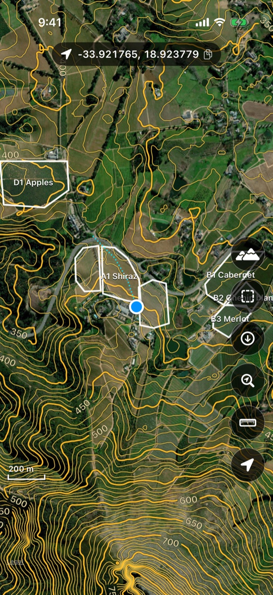 | 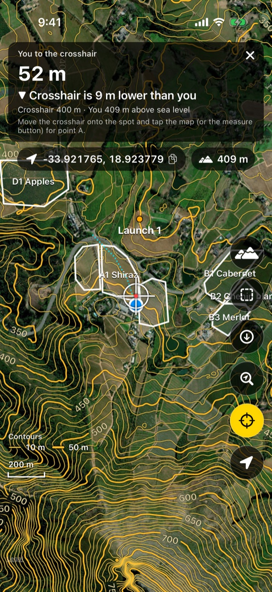 | 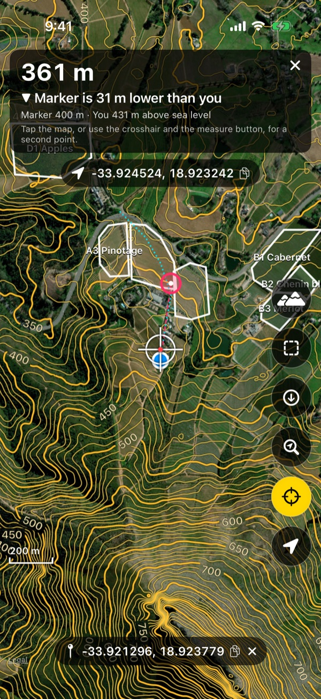 |
| **Blocks (KML files)** | **Blocks on the map** | **Offline maps** |
| 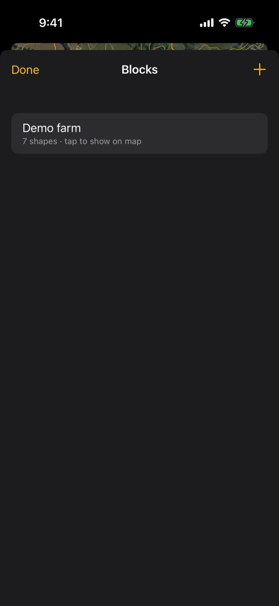 | 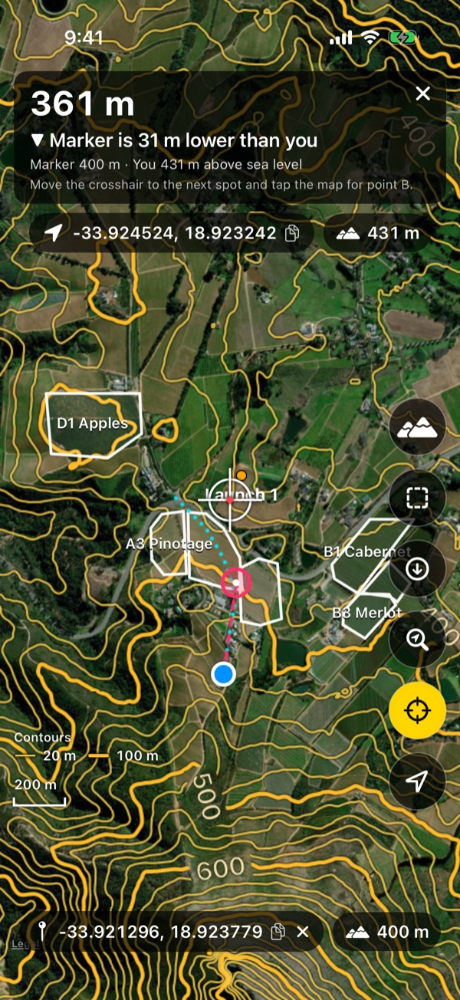 | 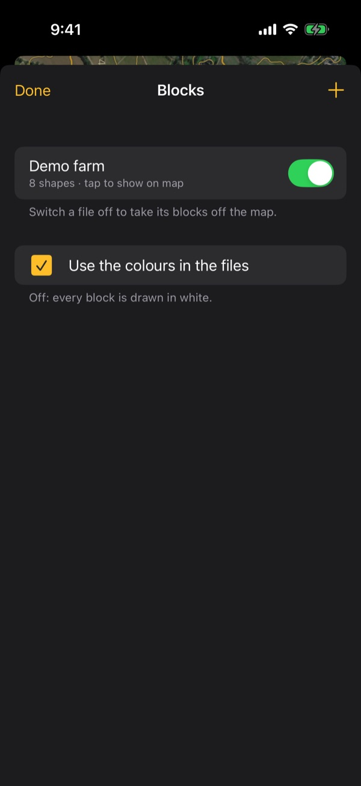 |
| **Download an area (from a KML)** | **Downloading** | **Offline areas** |
| 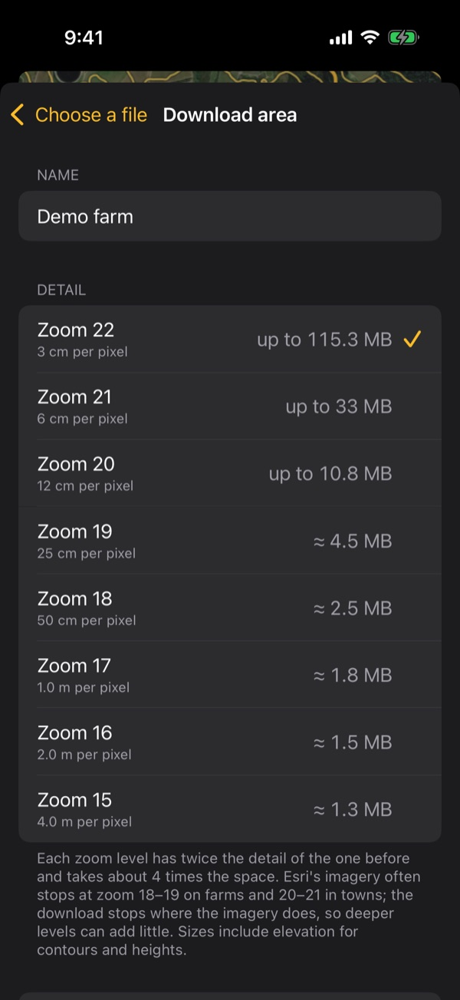 | 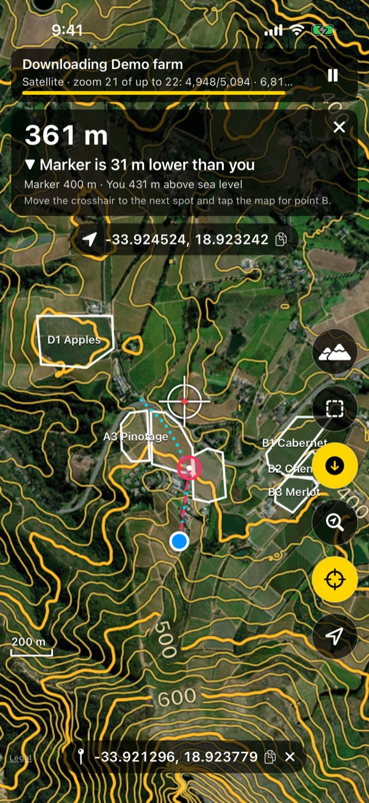 | 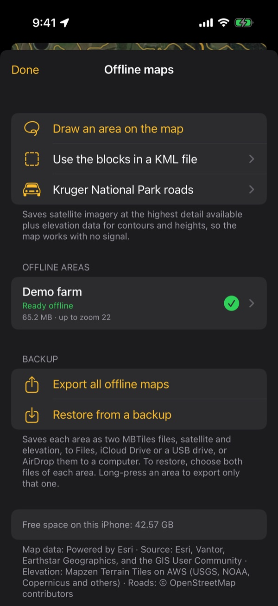 |
| **Drawing an area with the lasso** | **Contour lines switched off** | |
| 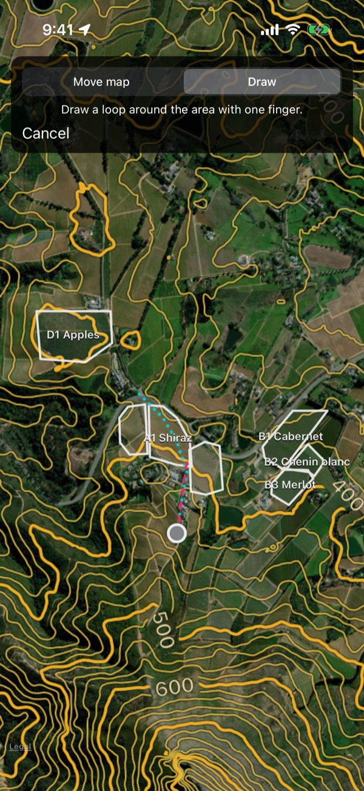 | 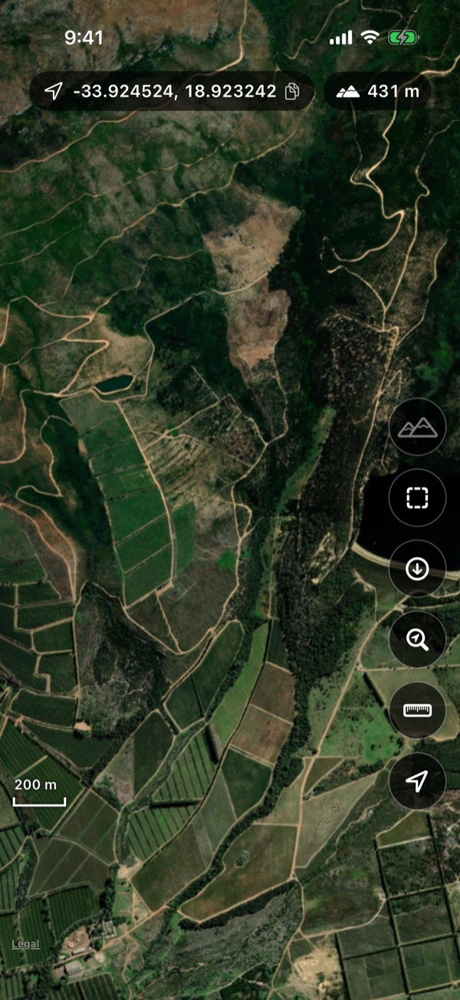 | |

## Features

| What you asked for | How it works |
| --- | --- |
| Satellite view | Esri World Imagery tiles drawn over MapKit (Apple's own map is switched off). |
| Contour lines | Drawn on the phone from elevation tiles (AWS Terrain Tiles). Spacing adapts to zoom: 100 m → 50 → 20 → 10 → 5 m, with every 5th line thicker and labelled. Works offline for downloaded areas. The mountain button at the top of the side buttons switches them on and off (remembered); while they are off, no elevation is downloaded for the map. |
| My location + dotted track | Blue dot (grey while the GPS sleeps) and a cyan dotted line of where you have been. Recording continues in the background. Long-press the locate button to clear the track. |
| KML blocks | **Blocks** button → **+** to import `.kml`/`.kmz` from Files, or share a KML from WhatsApp/Mail/Files to SatMap. Blocks are drawn in white with their names. Tap a file to zoom to it. Swipe to remove. |
| Measuring tool | Tap the ruler: a crosshair appears in the centre of the screen. Tap again: a marker is dropped under the crosshair. As you walk, a dashed line joins you to the marker and the panel shows the live distance and how much higher or lower the marker is than where you are (from the elevation model). Tap a third time to remove it. |
| Offline maps | **Offline** button → **Draw an area on the map** (switch between *Move map* and *Draw*, then draw a loop around the area with one finger), or **Use the blocks in a KML file** (downloads the blocks plus 150 m around them). Imagery is always saved at the highest detail available. Allow mobile data or wait for Wi-Fi, and download. |

### Offline downloads

- Imagery is downloaded zoom level by zoom level, up to zoom 22 (about 3–4 cm per pixel).
  Esri's imagery stops at different depths in different places, often zoom 18–19 on farms and 20–21 in
  towns. The downloader asks for a tile only if its parent exists, so it finds the real depth for every
  spot without wasting requests. On screen, anything deeper is enlarged from the best tile available.
- Elevation tiles for the same area are downloaded too, so contours and heights work with no signal.
- Keep SatMap open while it downloads; the screen stays on. In the background the download pauses so it
  can't compete with track recording for battery or CPU, and it continues when you return.
- Downloads resume where they stopped: after **Pause**, losing signal, leaving Wi-Fi, or closing the app.
  If the Wi-Fi is up but the internet behind it is down, the download waits and retries by itself.
  If the phone runs out of space, it stops and tells you.
- Each area is stored as two MBTiles files under *Application Support/SatMap/Offline* and is excluded
  from iCloud backup. Swipe an area to delete it and free the space.
- The size estimate is an upper bound. Most of the space goes into the deepest zoom levels.

### Battery

- **App on screen:** GPS at best accuracy, one position used every 2 s for the dot, track and measuring tool.
- **App in the background:** one position every 10 s. Between fixes the location accuracy is lowered
  to 3 km so iOS can power the GPS chip down. It is raised again 3 s before the next fix is due.
- **Not moving for 2 minutes:** sleep mode, with the GPS off. It wakes when the phone's motion
  coprocessor detects walking or driving. As a backup it also wakes after a short GPS check, every
  minute on screen or every 2 minutes in the background, if that check shows you have moved, or after a
  large jump in the coarse cell/Wi-Fi position.
- **Measuring:** while a marker is placed and the app is on screen, the sleep-mode GPS check runs every
  15 s instead of every minute, and reacts to moves of about 8 m. The distance then follows you even when
  motion detection misses a few steps.
- MapKit's own location tracking is not used, because it keeps the GPS at full power.

Limits imposed by iOS:
- The iPhone GPS cannot be polled every 2 s. While a fix is needed the chip runs continuously, and the
  saving comes from drawing and recording less often.
- With "While Using" location permission, recording stops if you force-quit the app (swipe it away),
  and starts again when you open it.
- With **Precise Location** turned off for SatMap, iOS only gives positions to within kilometres, so no
  track can be recorded. The app shows a warning when that happens.

## Install on your iPhone

### Without a Mac: sideload the test build

Download **[SatMap.ipa](https://github.com/JacobusOettle/satmap/releases/download/test-build/SatMap.ipa)**
(rebuilt automatically after every change to the app, `.github/workflows/ipa.yml`). It is unsigned: install it
with Impactor, Sideloadly or AltStore, which sign it with your Apple ID. With a free Apple ID it runs for 7 days,
then has to be installed again; your data is kept. On the iPhone, turn on *Settings → Privacy & Security →
Developer Mode* if asked, and trust your Apple ID under *Settings → General → VPN & Device Management*.

### With a Mac: build in Xcode

You need a Mac with **Xcode 16 or newer** and an iPhone with **iOS 16 or newer**.

1. Open `SatMap.xcodeproj` in Xcode.
2. Select the **SatMap** target → **Signing & Capabilities** → choose your **Team** (sign in with your
   Apple ID if asked). If Xcode says the bundle identifier is taken, change it, e.g. to
   `com.yourname.satmap`.
3. Connect the iPhone, select it as the run destination, and press **Run** (⌘R). The first time, on the
   iPhone open *Settings → General → VPN & Device Management* and trust your developer certificate.
4. When the app asks, allow **location** and **motion**.

With a free Apple ID the app expires after 7 days and must be run from Xcode again. Your data is kept.
A paid Apple Developer account ($99/year) extends this to a year, and also allows TestFlight.

## Map data and licensing — please read

- **Elevation:** [Terrain Tiles on AWS](https://registry.opendata.aws/terrain-tiles/) (Mapzen). Open data,
  free to download and store, with attribution.
- **Satellite imagery:** Esri World Imagery. Esri's terms allow using World Imagery with an ArcGIS
  account and taking it **offline only through Esri's own software**. Bulk-downloading the tiles into
  another app's storage, which is what the offline feature does, is not permitted by those terms. That
  includes personal use. Before relying on it, choose one of these:
  1. Keep the Esri source for viewing online. For licensed online use, create a free
     [ArcGIS Location Platform](https://location.arcgis.com) account (2 million basemap tiles per
     month free) and put its API key in `TileSources.esriAPIKey` in `SatMap/App/Config.swift`.
  2. Point `TileSources.imageryTemplate` at an imagery source you are licensed to store offline, such
     as your own drone orthomosaics served as XYZ tiles, or a provider that sells offline rights. Any
     `{z}/{x}/{y}` (or `{z}/{y}/{x}`) URL template works, and the downloader, offline store and
     overzoom work unchanged.
  3. For licensed offline Esri imagery, the map layer would have to be rebuilt on the ArcGIS Maps SDK
     for Swift, which exports tile packages offline with an ArcGIS account.

## Project layout

```
SatMap/
  App/        entry point, app state (AppModel), configuration, paths, connectivity
  Location/   LocationRecorder – GPS + motion power policy, track recording
  Map/        MapController (MKMapView), tile overlays, contour renderer, tile repository, overlays
  Offline/    OfflineManager – offline areas, download queue
  KML/        imported KML files
  UI/         SwiftUI screens
  Core/       platform-independent logic: tile maths, area → tile coverage, PNG/Terrarium decoding,
              marching-squares contours, KML/KMZ parsing, MBTiles (SQLite), track log, download engine
Tests/        unit tests for Core (run with `swift test`, also on Linux)
```

`Core` has no iOS dependencies, so it can be reused or ported (for example to Android) later.

### Why Swift and not Rust

Battery use is decided by how the GPS is driven, which is Core Location's job, and by the map
renderer, which is Apple's MapKit on Metal. Both are only available natively. A Rust core would add an
FFI layer and buy nothing, because the CPU work here is small: contour tiles, SQLite reads and HTTP.

## Development

```
swift test                     # core unit tests (macOS or Linux)
xcodebuild build -project SatMap.xcodeproj -scheme SatMap \
  -destination 'generic/platform=iOS Simulator' CODE_SIGNING_ALLOWED=NO
```

GitHub Actions (`.github/workflows/build.yml`) runs both on every push, with two Xcode versions.
